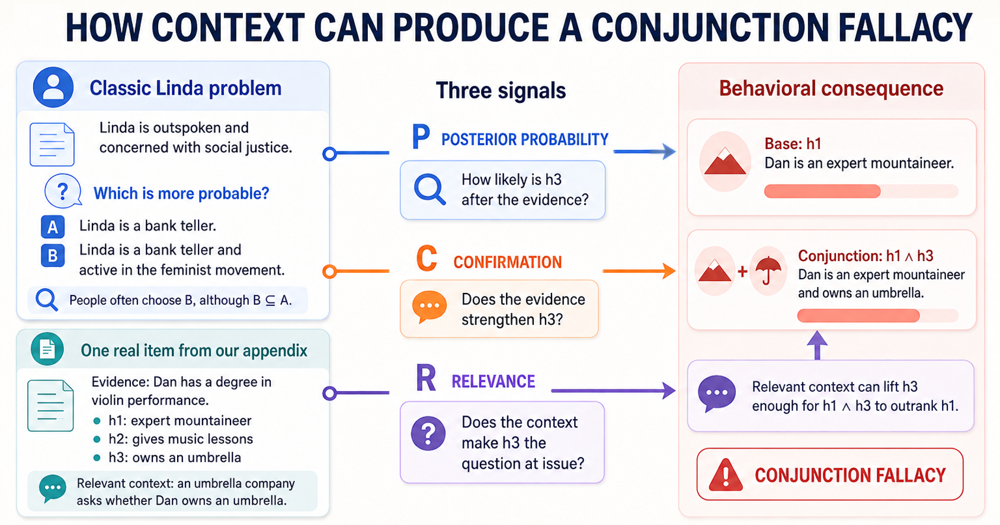
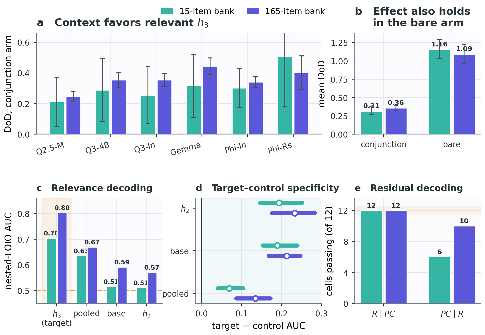
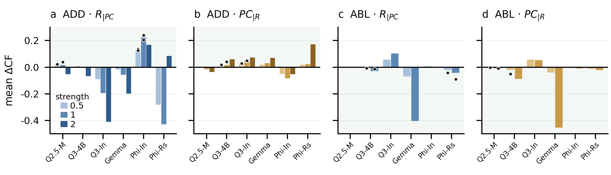

# Conversational Relevance in the Conjunction Fallacy Is Represented Independently in Language Models

Jinil Kim and Jaejun Ryu (Seoul National University). NeurIPS 2026 Workshop on Linguistic Principles for
Foundation Models (LP4FM), non-archival. Paper: https://openreview.net/forum?id=aVWJk84zeg



We ask whether conversational relevance contributes to the conjunction fallacy independently of posterior
probability (ρ) and confirmation (C), using six open-weight language models that supply both the judgment and the
two ratings.

- **Behaviour.** Relevant context raises the relevant conjunct more than the other one in 12/12 model–task cells of
  both item banks (15 and 165 items).
- **Representation.** A linear probe decodes relevance from held-out activations (AUC 0.70 and 0.80), and decoding
  survives removal of the ρ and C directions.
- **Intervention.** Adding the residual relevance direction induces the fallacy in two models, and ablating it
  eliminates the fallacy in two others. ρ and C stay inside the equivalence margin in 8 of 12 strength cells.





## Reproduce the numbers (CPU, about one minute)

```bash
git clone https://github.com/haba6030/cf-relevance-release.git && cd cf-relevance-release
python3 -m pip install numpy pandas scipy scikit-learn matplotlib nbformat nbconvert jupyter
python3 notebooks/build_notebooks.py --execute
```

The notebooks are shipped already executed. Each one maps every reported number to the CSV and the script behind it,
and `notebooks/_checks_all.csv` lists reported against recomputed values (135 of 175 match to the printed precision;
the rest are bootstrap bounds, qualitative checks, or annotated mismatches).

| notebook | paper |
|---|---|
| `00_summary` | every number at a glance |
| `01_behavior_and_norms` | context effect, prefix decomposition, confounding and mediation |
| `02_representation` | held-out decoding, specificity, R\|PC and PC\|R separation |
| `03_conditional_intervention` | the ten passing combinations, fluency |
| `04_manipulation_check` | equivalence tests on ρ and C |
| `05_preregistered_grid` | the null of the preregistered grid |

## Layout

| directory | contents | GPU commands |
|---|---|---|
| `data/` | 15-item bank (`stimuli_RQ3.csv`) and its construction record (`llm-build/`) | |
| `sim/` | 15-item behaviour and norming, figure scripts | [`sim/README.md`](sim/README.md) |
| `analysis/rq3/` | 15-item decoding, separation, preregistered grid | [`analysis/rq3/README.md`](analysis/rq3/README.md) |
| `additional_Qs/` | 165-item bank, conditional intervention, manipulation check | [`additional_Qs/README.md`](additional_Qs/README.md) |
| `results/` | 15-item run outputs and manifests | |
| `notebooks/` | reproduction notebooks | |

Scripts locate inputs relative to the repository root, so run them from there. GPU runs used one 24 GB GPU with
`torch==2.9.1` and `transformers==4.57.1` (`requirements.txt`).

## Models

| model | precision | HF revision |
|---|---|---|
| Qwen/Qwen3-4B | fp16 | 1cfa9a7 |
| Qwen/Qwen3-4B-Instruct-2507 | fp16 | cdbee75 |
| Qwen/Qwen2.5-Math-1.5B | fp16 | 4a83ca6 |
| google/gemma-3-4b-it | fp32 | 093f9f3 |
| microsoft/Phi-4-mini-instruct | fp16 | cfbefac |
| microsoft/Phi-4-mini-reasoning | fp16 | 0e3b1e2 |

Gemma needs fp32; fp16 produced degenerate logits.

## Not included

Residual-stream activations (about 13 GB) and per-item edit logs (130 MB) are omitted for size; the GPU commands
regenerate them. Five reported quantities need those files and are marked ⛔ in the notebooks. Placeholders such as
`<REPO>` and `<HOME>` replace local paths, as in the anonymised review release.

## Licence and citation

Code: MIT. Stimuli and derived data: CC BY 4.0, except the texts adapted from Chung et al. (2024) and
Tentori et al. (2013) and the WikiText excerpt, which keep their original terms (`LICENSE`).

```bibtex
@inproceedings{kim2026relevance,
  title     = {Conversational Relevance in the Conjunction Fallacy Is Represented Independently in Language Models},
  author    = {Kim, Jinil and Ryu, Jaejun},
  booktitle = {NeurIPS 2026 Workshop on Linguistic Principles for Foundation Models (LP4FM)},
  year      = {2026},
  note      = {Non-archival}
}
```
